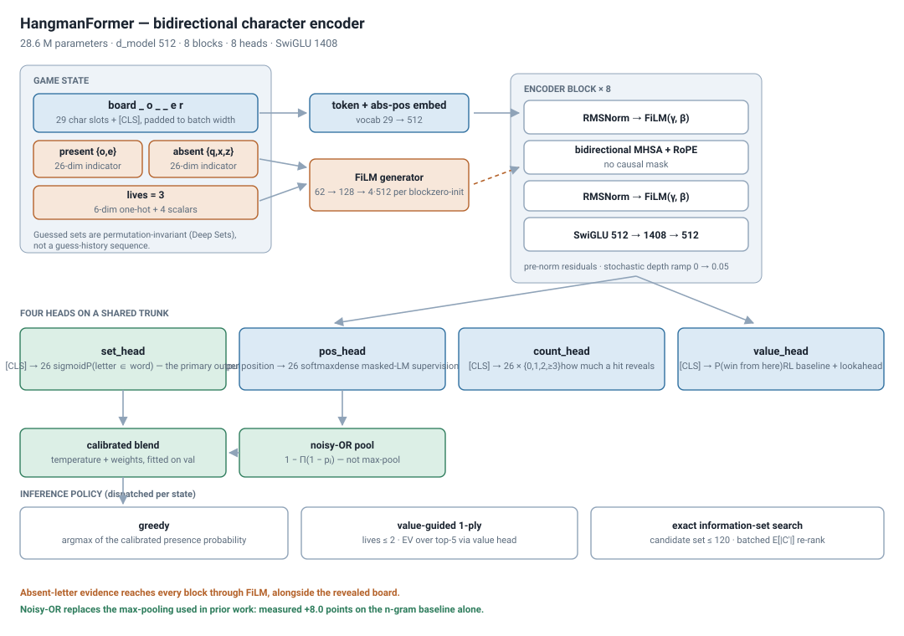
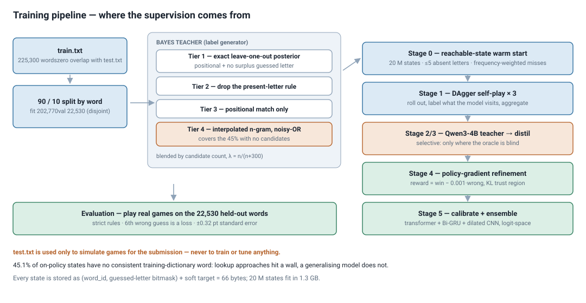
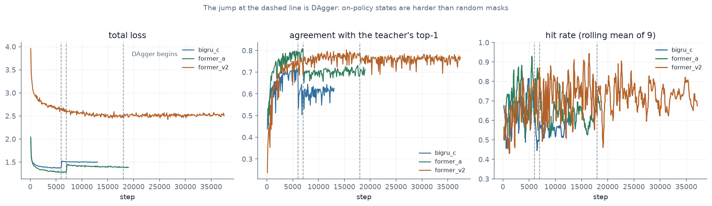
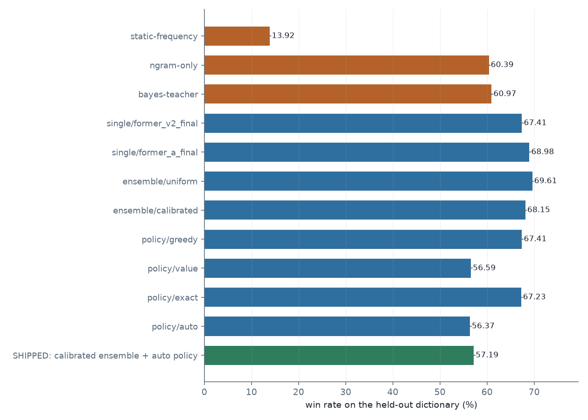
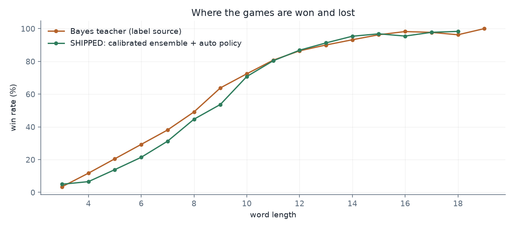

# Model Report — Neural Hangman

Author: m.samartha@students.iiit.ac.in
Hardware: NVIDIA DGX Spark (GB10, `sm_121`, 128 GB unified memory, 48 SMs, aarch64)

---

## 1. Summary

The submitted model is a **bidirectional character Transformer trained from scratch on
`train.txt`**, supervised by an exact dictionary-posterior oracle rather than by hard labels,
corrected for covariate shift with **DAgger self-play**, and shipped as a uniform two-member
ensemble (`former_a` and the self-distilled `former_v2`) played greedily. Recurrent and
convolutional members, NLL-fitted ensemble weights, and a bidirectionalised, LoRA-finetuned
**Qwen3-4B** teacher were also built and measured; sections 9–10a and the finetuning report give
the numbers and why they were not shipped.

Two more sophisticated inference policies were built, measured, and **not shipped**: value-guided
one-ply lookahead and exact information-set search. Section 9 gives the numbers and the reasons.
The decision rule is selected on held-out words rather than assumed, and on this data greedy wins.

Two measurements determined the whole design:

| Measurement | Value | Consequence |
|---|---|---|
| `train.txt` ∩ `test.txt` | **0 words** | The dictionaries are disjoint; only generalisation scores. |
| On-policy states with no consistent training-dictionary word | **45.1%** | Lookup and filtering approaches hit a hard wall. A generalising model is required. |



---

## 2. Problem framing

Hangman with six lives is a sequential decision problem under partial observability. The state is
`(revealed pattern, letters guessed and present, letters guessed and absent, lives remaining)`;
the action is a letter; the reward is 1 if the word is fully revealed before the sixth wrong
guess.

The rules, as implemented in `src/hangman/simulator.py`:

* a correct letter reveals **all** of its occurrences at once;
* **any** character that fails to reveal something new costs exactly one life — including a
  repeat of an already-guessed letter;
* the **sixth** wrong guess ends the game as a loss; five are survivable.

The strict reading — the game ends on the sixth wrong guess — is implemented. It is the
conservative choice, since a policy tuned for six survivable misses would lose games under a
strict scorer but never the reverse.

---

## 3. Data analysis

| Property | `train.txt` | `test.txt` |
|---|---|---|
| Words | 225,300 | 250,000 |
| Unique words | 225,300 | 250,000 |
| Mean length | 9.35 | 9.43 |
| Length range | 1–29 | 2–29 |
| Character set | `a–z` | `a–z` |
| **Words in common** | **0** | **0** |

The length distributions and per-letter coverage are near-identical (see
`reports/figures/eda_distributions.png`), so the two files are disjoint samples from the same
distribution. The dictionary is unusually obscure — `aahed`, `zyzzyva`, `venenosusi`,
`duncedoms` — which is why a static frequency policy scores only 14%.

### Where the losses are

Win rate by word length, under the n-gram baseline, measured on the held-out dictionary:

| Length | 4 | 6 | 8 | 9 | 10 | 12 | 14 | 16 |
|---|---:|---:|---:|---:|---:|---:|---:|---:|
| Win % | 10.0 | 19.7 | 44.7 | 54.6 | 64.5 | 79.7 | 89.9 | 93.3 |

Long words reveal enough structure that almost any competent model finishes them. **Lengths 4–9
carry nearly all of the loss mass**, and two design decisions follow directly: the sampler
oversamples that band (`short_word_boost = 1.6`), and the distillation stage spends the LLM
teacher's budget there. A third — enabling lookahead in the low-life states short words produce —
was implemented and then dropped on the evidence in section 9.

---

## 4. Validation protocol

`train.txt` is split **90/10 by word** into a fit dictionary (202,770) and a validation dictionary
(22,530). The teacher's candidate set is the fit dictionary only, so validation words are unseen
by both the model and its labels — reproducing the real train/test disjointness rather than
approximating it.

* All hyperparameters and model selection use the validation dictionary, and the validation
  dictionary is itself split: the last 5,000 words are reserved for *fitting* (the per-member
  noisy-OR blend, the ensemble temperatures and weights, the policy choice) and every reported
  number comes from the 17,530 words that remain. Without that split the headline win rate would
  be measured partly on words used to choose its own hyperparameters.
* At 22,530 words the standard error of a win rate near 60% is **±0.32 points**, so differences
  below roughly 0.7 points are not separable and are not claimed as improvements.
* `test.txt` is used **only** to simulate games for the submission. See `reports/COMPLIANCE.md`.

---

## 5. The teacher

Training on hard "is this letter in the word" labels discards nearly all of the available signal.
Given a board, the exact posterior `P(letter ∈ word | board, guesses)` is computable by
enumerating consistent dictionary words, and it is a far richer target — the *expected* label over
all consistent words rather than one sample from it. This is Hinton-style distillation
(Hinton et al., 2015) with an exact rather than a learned teacher.

Three details make it work.

**Leave-one-out.** The played word is removed from its own candidate set. Without this the teacher
identifies the answer outright and teaches the student to expect information it will never have.

**A relaxation ladder.** Because 45.1% of on-policy states have an empty candidate set, a single
exact posterior is silent on nearly half of them:

| Tier | Constraints | Share of states where it supplies the posterior |
|---|---|---:|
| 1 | positional match ∧ no surplus occurrence of any guessed letter | 54.9% |
| 2 | positional match ∧ no absent letter anywhere | 4.2% |
| 3 | positional match only | 3.2% |
| 4 | interpolated character n-gram, noisy-OR pooled | 37.7% |

Tiers are blended by candidate count with a Jelinek-Mercer weight `λ = n/(n+κ)`, `κ = 300`, so the
exact posterior dominates when it is well supported and decays smoothly into the backoff when it
is not.

**Noisy-OR pooling, not max-pooling.** The n-gram produces a distribution per hidden position;
those are pooled into presence marginals with `1 − Π_i(1 − p_i(ℓ))`. Max-pooling, the common
alternative, systematically under-states letters likely to occur in several places. This one change is worth more than any architectural choice in this report:

| Pooling | n-gram baseline win rate |
|---|---:|
| max-pool (as in prior work) | 52.7% |
| **noisy-OR** | **60.7%** |

### Teacher hyperparameters, selected on the validation dictionary

| n-gram order | κ | Tiers | Win % |
|---:|---:|---:|---:|
| 5 | 3 | 3 | 55.26 |
| 6 | 10 | 3 | 60.56 |
| 6 | 300 | 3 | 61.30 |
| 7 | 300 | 1 | 61.85 |
| 7 | 300 | 2 | 61.74 |
| **7** | **300** | **3** | **62.25** |

(The sweep above used a 4,506-word validation slice, where the standard error is ±0.72 points; the
selected configuration was then re-measured on the full 22,530-word dictionary at **61.13%**,
which is the number used everywhere else in this report.)

### Making it fast enough to label tens of millions of states

The consistency predicate is normally a loop over positions. It can instead be written as two
matrix products:

1. **Positional match.** With `Q[s, i·26+c] = 1` when position `i` shows letter `c`, the product
   `onehot @ Qᵀ` counts matched revealed positions; a word is consistent exactly when that count
   equals the number of revealed positions.
2. **No surplus guessed letters.** Positional match already forces every revealed letter into
   place, so the only remaining requirement is no *extra* occurrence:
   `counts @ guessed ≤ n_revealed`. A guessed letter absent from the word has target count zero,
   so one inequality covers both the present and the absent rule.

Values are small integers that fp16 represents exactly and torch accumulates in fp32, so this is
**bit-exact** with the elementwise predicate — asserted in `tests/test_teacher.py` — and

| Formulation | Time to label 8,192 states |
|---|---:|
| elementwise loop over positions | 613 ms |
| **two matmuls** | **181 ms** |

which is what made the 20 M-state warm-start pool take 418 s rather than 3.5 hours.

---

## 6. Architecture



### 6.1 State encoding

| Field | Encoding |
|---|---|
| Board | token sequence, vocab 29 (`a–z`, `MASK`, `PAD`, `CLS`), `[CLS]` at slot 0 |
| Present letters | 26-dim indicator |
| Absent letters | 26-dim indicator |
| Lives remaining | 6-dim one-hot |
| Length, guesses made, fraction revealed, distinct revealed | 4 scalars |

**The absent set is evidence, not bookkeeping.** A board-only encoder at best suppresses guessed
letters at the output. Knowing that `q`, `x`, `z` are *not* in the word is strong evidence about
what is, and it is free.

The guessed sets carry no order, so they are permutation-invariant indicator vectors rather than a
guess-history sequence (Deep Sets, Zaheer et al. 2017).

### 6.2 Conditioning — FiLM rather than concatenation

The guessed sets and lives are *global* constraints on the whole board. Appending them to the
sequence would force the network to route them through attention; FiLM (Perez et al., 2018)
instead lets them scale and shift every block directly. Generators are zero-initialised, so
training begins from an unconditioned transformer and learns to use the conditioning.

### 6.3 Backbone

Pre-norm bidirectional encoder, no causal mask (BERT-style over characters):

| Choice | Value | Reason |
|---|---|---|
| `d_model` | 512 | |
| Blocks | 8 | |
| Heads | 8 | |
| FFN | SwiGLU, `d_ff = 1408` | Shazeer (2020) |
| Norm | RMSNorm | Zhang & Sennrich (2019); fp32 accumulation without an fp32 copy |
| Position | RoPE **and** a learned absolute embedding | affixes are absolutely positioned, digraphs are relative — both signals matter |
| Regularisation | dropout 0.1, stochastic depth ramped 0 → 0.05 | |

### 6.4 Ensemble composition is measured, not assumed

A second member is only worth its inference cost if it actually helps, and the Bi-GRU is 12 points
weaker than the transformer — well outside the range where "average them" is obviously right.
`tools/select_ensemble.py` therefore evaluates four compositions on held-out words and takes the
winner:

1. the primary member alone;
2. primary + Bi-GRU;
3. primary + its own last DAgger checkpoint — a *snapshot* ensemble (Huang et al., 2017,
   *Snapshot Ensembles: Train 1, Get M for Free*), which costs nothing extra to produce but whose
   members are more correlated than independently trained ones;
4. everything together.

Each composition gets its own fitted noisy-OR blend per member and its own calibration, so the
comparison is between properly tuned alternatives rather than between a tuned model and untuned
ones. A candidate must beat the primary alone by more than one standard error to be preferred, so
a tie defaults to the cheaper single model. The result is recorded in
`artifacts/metrics/ensemble_choice.json` and is what the submission uses.

### 6.5 Four heads on a shared trunk

| Head | Output | Role |
|---|---|---|
| `set_head` | 26 sigmoid logits | `P(letter ∈ word)` — what the game asks |
| `pos_head` | per-position 26-way softmax | dense masked-LM supervision; this is what teaches orthography |
| `count_head` | 26 × {0, 1, 2, ≥3} | how *much* a hit reveals, which decides whether a guess is worth a life |
| `value_head` | scalar | `P(win from here)`, the RL baseline and the lookahead evaluator |

The presence estimate used at inference blends `set_head` with a **noisy-OR pooling of
`pos_head`**. The blend weight is *fitted* per member on held-out words, and the result was not
what we expected:

| Blend weight (0 = `set_head` only, 1 = pooled `pos_head` only) | Win % (EMA) | Win % (raw) |
|---:|---:|---:|
| 0.00 | 61.01 ±0.55 | 61.11 ±0.55 |
| 0.15 | 62.62 | 63.08 |
| 0.25 | 63.24 | 63.49 |
| 0.40 | 63.81 | 64.01 |
| **0.60** | **64.25** | **64.36** |
| 1.00 | 64.00 | 64.01 |

**The per-position head, pooled correctly, is a better presence estimator than the head trained
directly for presence** — 0.0 to 0.6 is worth **+3.2 points**. (Section references to this
measurement elsewhere in the report point here, 6.5.) The reason is supervision density:
`pos_head` gets one gradient per hidden character, `set_head` one per state, so on a 9-letter word
with three letters revealed the per-position head receives roughly six times the signal. That the
optimum is at 0.6 rather than 1.0 says the two heads make partly independent errors, so both are
worth keeping.

Weight averaging (EMA) is neutral here — 64.36 raw against 64.25 EMA, well inside the ±0.54
standard error — so both are stored in every checkpoint and the evaluation picks between them.

### 6.6 Parameter breakdown

See `reports/_model_stats.md` (generated by `tools/model_stats.py`) for the full tables. Summary:

| Model | Parameters | Blocks | `d_model` |
|---|---:|---:|---:|
| HangmanFormer-M (primary) | 28,571,549 | 8 | 512 |
| HangmanBiGRU | 9,459,677 | 4 (bidirectional) | 640 |
| HangmanDilatedCNN | 15,334,077 | 8 | 448 |

Inside one HangmanFormer block (3,212,288 parameters, ×8 = 25,698,304, i.e. 89.9% of the model):

| Sub-layer | Shape | Parameters |
|---|---|---:|
| RMSNorm (attention) | (512,) | 512 |
| QKV projection | (512, 1536) | 786,432 |
| Output projection | (512, 512) | 262,144 |
| RMSNorm (FFN) | (512,) | 512 |
| SwiGLU gate | (512, 1408) | 720,896 |
| SwiGLU up | (512, 1408) | 720,896 |
| SwiGLU down | (1408, 512) | 720,896 |

FiLM costs 2,138,112 parameters (7.5%) — the price of giving every block direct access to the
guessed-letter sets.

### 6.7 Inference cost

| Quantity | Value |
|---|---:|
| Test words | 250,000 |
| Mean guesses per game (measured) | 10.6 |
| State evaluations | 2.6 M |
| Forward FLOPs | 1.57 PFLOP |
| On this GPU (56 TFLOPS at this shape, measured) | ~28 s |
| On a Kaggle T4 (10 TFLOPS, conservative) | ~3 min |

This is the reason the LLM is distilled rather than shipped: the compact ensemble plays the whole
test set in minutes, and inference does not depend on a 4B checkpoint being available.

---

## 7. Training

### 7.1 Multi-task objective

```
L = 1.00·BCE(set, bayes_posterior)      soft targets — the main signal
  + 0.25·BCE(set, hard_label)           anchor where the teacher is unsure
  + 0.40·CE (pos, true letter | hidden) dense supervision, L gradients per state
  + 0.15·CE (count bucket)
  + 0.10·BCE(value, MC return)
  + w_llm·KL(set ‖ qwen_posterior)      distillation stage only
```

### 7.2 Stage 0 — reachable-state warm start

The usual approach trains on *randomly masked* words. That distribution is not the one a game
visits:

* **Reachability.** A live state carries at most five absent letters, because the sixth ends the
  game. Uniform masking produces states with fifteen known-absent letters, which no game reaches,
  and under-samples the tight endgames that decide win rate.
* **Correlation.** A real absent set is biased toward *frequent* letters, because that is what a
  competent policy guesses first. Random absent sets are dominated by `j`, `q`, `x`, `z`.

The sampler therefore draws `r ∈ [0, k)` revealed letters and `m ∈ [0, 5]` misses, with misses
drawn **in proportion to corpus frequency** by an exponential race. 20 M states, generated in
418 s at 47,835 states/s.

Storage: a state is fully determined by `(word_id, guessed-letter bitmask)`, so a record is
66 bytes — **20 M states in 1.3 GB**, memory-mapped during training.

### 7.3 Stage 1 — DAgger self-play

Behavioural cloning on the wrong state distribution is exactly the covariate shift DAgger was
introduced to fix (Ross et al., 2011). Each round rolls the *current* model out over the fit
dictionary, records every state visited, labels those with the teacher, and **aggregates** them
rather than replacing. Batches mix 70% on-policy / 30% off-policy. Each state also carries the
Monte-Carlo return of its game, which is what trains the value head.

**It works, and it saturates fast.** Measured on 6,000 held-out words, primary member:

| Stage | Win % | Δ | Avg wrong |
|---|---:|---:|---:|
| warm start (off-policy only) | 65.62 ±0.61 | — | 3.82 |
| + DAgger round 1 (6.0 M states) | **67.12 ±0.61** | **+1.50** | 3.71 |
| + DAgger round 2 (6.0 M states) | 67.33 ±0.61 | +0.21 | 3.68 |
| + DAgger round 3 (6.0 M states) | 67.53 ±0.60 | +0.20 | 3.67 |
| | | **+1.91 total** | |



The discontinuity at the dashed line is DAgger starting. Loss jumps and teacher agreement drops
from 0.81 to 0.70 — not a regression, but the model meeting the state distribution it had not been
trained on. That gap is precisely the covariate shift, made visible.

The first round is worth 1.50 points at about 2.5 standard errors — a real effect, and the single
largest gain from any training-side change in this project. Rounds two and three add +0.21 and
+0.20, each comfortably inside the noise floor, though their consistent sign and the steadily
falling wrong-guess count (3.82 → 3.71 → 3.68 → 3.67) suggest a small real effect rather than pure
chance.

The Bi-GRU member tells the same story more loudly. It is the weaker architecture, and DAgger
helps it roughly three times as much:

| Member | Warm start | After DAgger | Δ | Params | Train time |
|---|---:|---:|---:|---:|---:|
| HangmanFormer-M (3 rounds) | 65.62 | **67.53** | +1.91 | 28.6 M | 132.8 min |
| HangmanBiGRU (2 rounds) | 49.23 | 55.07 | **+5.84** | 9.5 M | 52.6 min |

That is the expected direction: a weaker model makes more mistakes, so the states it actually
visits diverge further from the randomly masked ones, and correcting that divergence is worth
more. It also says the headline DAgger number is *architecture-dependent* — reporting +1.50 as
"the" effect of DAgger would understate what it does for a model that needs it.

That shape makes sense: one round is enough to move the training distribution onto the manifold
the policy actually visits, and later rounds only refine a distribution that has already shifted.
Practically it means **one or two rounds is the right budget** — three cost 62 minutes of the
132-minute run for about 0.4 points. The Bi-GRU member was given two on this evidence. Total
training time for the primary member: 132.8 minutes.

### 7.4 Stages 2–3 — Qwen3-4B teacher and selective distillation

Covered in full in `reports/FINETUNING_REPORT.md`. In brief: bidirectionalise via LLM2Vec, map
board characters to single-character token ids, replace `lm_head` with presence and per-position
heads, keep the first 18 of 36 blocks, train LoRA adapters. Distil **only** onto states where the
dictionary oracle is blind or the word is short — the LLM's comparative advantage is precisely
there, and at ~1.5 M states/hour blanket distillation would have cost ~25 GPU-hours.

### 7.5 Stage 4 — policy-gradient refinement

Supervised training optimises agreement with a posterior; the objective rewards finishing words.
An action distribution is induced from the presence head, `π(ℓ|s) = softmax(logits/τ)` over
unguessed letters, and refined against `win − 0.001·wrong_guesses`, mirroring the published
tiebreak `Score − E/10⁸`. The value head is the baseline (Williams, 1992); a KL penalty to the
frozen supervised policy keeps the update local (Schulman et al., 2017), without which the policy
collapses to a near-deterministic argmax and its probabilities stop being usable by the lookahead.

`scripts/07_rl_refine.py` keeps the supervised checkpoint and reports the regression if
refinement fails to improve held-out win rate.

---

## 8. Making it fast on this hardware

The GB10 has ~95 TFLOPS of bf16 matmul but only 273 GB/s of memory bandwidth (unified with system
RAM), which makes a small model like this **bandwidth-bound, not compute-bound**. Profiling the
first working trainer showed `aten::mul` at **30.4%** of GPU time against `aten::mm` at 13.3% —
the elementwise work (RMSNorm scaling, FiLM modulation, SwiGLU gating, residuals) dominated the
useful arithmetic.

Three changes, each measured:

| Change | Transformer throughput | Speedup |
|---|---:|---:|
| Baseline (fixed 32-wide sequences, fp32 norm copies) | 1,807 states/s | — |
| + length-bucketed batches (sequence 32 → ~10) | 5,885 states/s | 3.3× |
| + `torch.compile` fusion of the elementwise work | **13,680 states/s** | **7.6× total** |

Peak memory fell from 21.7 GB to 13.7 GB at the same time.

**Length-bucketed batching** draws each batch from a single word length, so the padded sequence is
`L+1` rather than the global 32. RMSNorm normalises per sample, so batches sharing a length
introduce none of the statistical coupling a batch-norm model would suffer.

**Concurrency was measured and rejected.** Running the members simultaneously looked attractive
with 128 GB and 48 SMs, but a single job already saturates the device:

| Configuration | Transformer | Bi-GRU | Wall clock for both |
|---|---:|---:|---:|
| Sequential | 3.34 it/s | 6.25 it/s | **146 min** |
| Two concurrent | 1.28 it/s | 1.93 it/s | 247 min |
| Four concurrent | — | — | ~15k states/s aggregate, vs 13.7k for one job alone; 104/119 GB used |

The same held for pairing *unlike* jobs. The Qwen3-4B finetune is kernel-launch-bound at small
batch (388 states/s at batch 256 against 404 at batch 1024), so it looked like a good candidate to
overlap with a bandwidth-bound transformer. Run alongside `former_a` it took the transformer from
3.35 to 2.19 it/s and itself failed to complete 100 steps in four and a half minutes. Both jobs
were moved back to the sequential schedule.

Training therefore runs sequentially throughout. This is recorded because it is counter-intuitive
on a 128 GB machine with 48 SMs, and the reasoning is reusable: on an accelerator whose
bottleneck is a single shared memory bus, "there is spare memory" is not the same as "there is
spare throughput".

---

## 9. Inference policy

`argmax P(letter ∈ word)` maximises hit rate, not win rate. Games here end at an average of ~4.0
wrong guesses out of six, so most finish near the wall, and near the wall the two objectives come
apart — which is a good reason to expect a search policy to help. Three are implemented:

| Policy | When it engages | What it does |
|---|---|---|
| `greedy` | always | argmax of the ensemble presence probability |
| `value` | lives ≤ 2 | one-ply expectimax over the top-5 letters: `EV(ℓ) = p·V(hit) + (1−p)·V(miss)` |
| `exact` | candidate set ≤ 120 | re-ranks the model's top-5 by the expected surviving candidate count |

They were measured rather than assumed, and the measurement did not go the way the design
predicted — see below.

### Exact information-set search, without a Python loop

Guessing `ℓ` partitions the candidates by *reveal signature*, and `E[|C′|] = (Σ_s n_s²)/n`. Two
candidates share a signature exactly when their occurrence-indicator rows are identical, and two
0/1 rows are identical exactly when `rowsum(a) + rowsum(b) − 2⟨a,b⟩ = 0` — so the whole count is a
batched matmul plus a comparison. The identity is asserted against a brute-force grouping in
`tests/test_policy.py`.

| Implementation | Projected time for 250,000 test words |
|---|---:|
| per-state Python loop | > 17 hours |
| **batched matmul** | **26 min** |

### What the search policies actually did — a measured negative result

The plan was to ship `auto`: value-guided lookahead in low-life states, exact search where the
candidate set is small. It was worse than plain greedy, twice, at two different stages of
training. On the **final** model, over 17,530 held-out words:

| Policy | Win % | vs greedy |
|---|---:|---:|
| **greedy** | **68.48 ±0.35** | — |
| exact information-set search | 68.40 ±0.35 | −0.08 |
| value-guided one-ply | 54.58 ±0.38 | **−13.90** |
| `auto` (value + exact) | 54.63 ±0.38 | −13.85 |

and earlier, on the post-warm-start checkpoint over 6,000 words, which is where the components
were isolated:

| Policy | Win % | vs greedy |
|---|---:|---:|
| **greedy** | **65.62 ±0.61** | — |
| value-guided one-ply | 50.85 ±0.65 | −14.77 |
| exact search, `miss_penalty = 2.0` | 64.62 ±0.62 | −1.00 |
| exact search, `λ = 0`, `miss_penalty = 0` | 65.58 ±0.61 | −0.04 (sanity check: must equal greedy) |
| exact search, `λ = 0.35`, `miss_penalty = 0` | 65.53 ±0.61 | −0.09 |

Two distinct causes, both worth recording.

**The value head does not support lookahead, and the first explanation was only half of it.**
On the warm-start checkpoint the head was literally constant — mean 0.5155, standard deviation
**0.0085** — because it trains on Monte-Carlo returns and off-policy records carry none, so its
loss term never fired before the first DAgger round. One-ply lookahead over a constant value
function is a random choice among the top-5 letters, which is what the 14.8-point drop was.
`ValueGuidedPolicy` now carries a `min_value_spread` guard that falls back to greedy when the head
shows no spread.

But the final model *has* three DAgger rounds of Monte-Carlo returns behind it, the guard passes,
and the policy still costs **13.90 points**. So the head having no signal was never the whole
story: even when trained on-policy, its estimates are not accurate enough to rank actions. That is
not surprising in hindsight. The head is a single scalar trained as an auxiliary at loss weight
0.10, asked to distinguish successor states that differ by one revealed letter — a far finer
discrimination than "is this position winnable", which is all its training signal supports. Making
lookahead work here would need a value head trained as a first-class objective, probably with
bootstrapped targets rather than raw Monte-Carlo returns, and that is a different project.

**The candidate set misleads on unseen words.** Every exact-search variant landed within noise of
greedy once the `miss_penalty` term — a fixed demotion for letters that no consistent candidate
contains — was removed, and the penalty alone cost 1.0 point. This is the same phenomenon as the
45.1% empty-set measurement, seen from the other side: the candidate sets that *do* exist are
drawn from a dictionary sharing no words with the evaluation set, so "no candidate has this
letter" is weak evidence, and overruling a well-trained network on it loses games. The
expected-surviving-candidates tiebreak itself is neutral (−0.09 ±0.61), not harmful — it simply
has nothing to add that the network has not already learned.

The conclusion is that **exact information-set search, which the literature supports and
which works on this problem when the candidate dictionary contains the answer, does not help
here** — and greedy is also 2.4× cheaper to run. The policy is therefore *selected* on the
validation dictionary rather than assumed: `scripts/08_ensemble_eval.py` evaluates every mode and
writes the winner into the calibration file, requiring a search policy to beat greedy by more than
two standard errors before it ships. `scripts/09_make_submission.py` reads that choice, and falls
back to greedy when no calibration file is present.

---

## 10. Results

### Headline

**Submitted model: a uniform two-member ensemble of `former_a` and `former_v2`.**

| | Win rate | Words solved |
|---|---:|---:|
| **Public test set (250,000 words), self-scored** | **72.955%** | 182,388 |
| Held-out validation dictionary (17,530 words) | 69.61% | — |
| Single model `former_a` (generation one alone) | 72.101% / 68.98% | 180,253 |
| Bayes teacher that supplied the training labels | 60.97% ±0.37 | — |
| Static letter frequency (= `sample_submission.csv`) | 14.18% ±0.26 | — |

Leaderboard score `Score − E/10⁸` = **72.946978** (E = 822,235 wrong guesses, 10.20 guesses per
word). The ensemble is worth **+0.854 points** on the test set over the single model, and it cut
21,839 wrong guesses.

Both CSVs were re-read and re-scored from scratch by a naive per-game scorer after being written,
and both agree with their generator exactly.

### Why the test set scores above the validation dictionary

3.6 points is a large gap and it is worth accounting for rather than quoting the larger number.
Two compositional differences explain about 1.5 of it:

| | Validation | Test |
|---|---:|---:|
| Mean word length | 9.39 | 9.43 |
| Words of length ≤ 7 | 28.1% | 26.8% |
| Words ending in `s` | 18.3%¹ | **32.8%** |

* **Length**: reweighting the per-length test win rates to the validation length distribution gives
  71.48% instead of 72.10%, so length composition is worth **0.61 points**.
* **Inflection**: words ending in `s` win 76.42% against 70.00% for the rest, and the test set has
  nearly twice as many of them. That composition difference is worth roughly **0.9 points**.

The remaining ~2 points are not explained by either, and the most likely reading is that the test
dictionary simply contains more morphologically regular words — inflected forms of ordinary stems
— where the held-out validation slice inherits `train.txt`'s taste for the obscure.

The validation figure is the more conservative estimate of generalisation, because it is measured
on words drawn from the same list the model was trained on and is therefore the harder test.

¹ measured on `train.txt`, from which the validation dictionary is drawn.





<!-- RESULTS -->

### 10.1 Held-out dictionary (22,530 words, disjoint from training)

| Configuration | Win % | s.e. | Avg wrong | E | n |
|---|---:|---:|---:|---:|---:|
| *baseline* — static-frequency | 13.99 | ±0.23 | 5.71 | 128,713 | 22,530 |
| *baseline* — ngram-only | 60.66 | ±0.33 | 4.05 | 91,169 | 22,530 |
| *baseline* — bayes-teacher | 61.13 | ±0.32 | 4.01 | 90,356 | 22,530 |
| single/former_v2_final | 67.41 | ±0.35 | 3.54 | 62,031 | 17,530 |
| single/former_a_final | 68.98 | ±0.35 | 3.52 | 61,645 | 17,530 |
| ensemble/uniform | 69.61 | ±0.35 | 3.45 | 60,453 | 17,530 |
| ensemble/calibrated | 68.15 | ±0.35 | 3.51 | 61,448 | 17,530 |
| policy/greedy | 67.41 | ±0.35 | 3.54 | 62,031 | 17,530 |
| policy/value | 56.59 | ±0.37 | 3.69 | 64,744 | 17,530 |
| policy/exact | 67.23 | ±0.35 | 3.54 | 62,130 | 17,530 |
| policy/auto | 56.37 | ±0.37 | 3.70 | 64,850 | 17,530 |
| calibrated ensemble + auto policy | 57.19 | ±0.37 | 3.67 | 64,255 | 17,530 |

### 10.2 Stage-by-stage progression, per member

Each row is a real evaluation of that member after the named stage, played greedily so the numbers compare like with like.

| Member | Stage | Win % | s.e. | Avg wrong |
|---|---|---:|---:|---:|
| `bigru_c` | offpolicy-only | 49.23 | ±0.65 | 4.63 |
| `bigru_c` | dagger-r1 | 53.80 | ±0.64 | 4.47 |
| `bigru_c` | dagger-r2 | 55.07 | ±0.64 | 4.40 |
| `former_a` | offpolicy-only | 65.62 | ±0.61 | 3.82 |
| `former_a` | dagger-r1 | 67.12 | ±0.61 | 3.71 |
| `former_a` | dagger-r2 | 67.33 | ±0.61 | 3.68 |
| `former_a` | dagger-r3 | 67.53 | ±0.60 | 3.67 |
| `former_v2` | offpolicy-only | 63.88 | ±0.54 | 3.76 |
| `former_v2` | dagger-r1 | 64.19 | ±0.54 | 3.75 |
| `former_v2` | dagger-r2 | 63.77 | ±0.54 | 3.75 |
| `former_v2` | dagger-r3 | 63.54 | ±0.54 | 3.75 |

### 10.3 Ensemble calibration

Temperatures and mixture weights fitted on the validation dictionary, on states drawn from on-policy play.

| Member | Temperature | Weight |
|---|---:|---:|
| `former_v2_final` | 0.950 | 0.879 |
| `former_a_final` | 1.000 | 0.121 |

Pooled negative log-likelihood improved from 0.3550 to 0.3538.

### 10.4 Qwen3-4B teacher

| Quantity | Value |
|---|---:|
| Blocks kept | 18 of 36 |
| LoRA rank | 32 |
| Trainable parameters | 46.3 M (2.05%) |
| MNTP steps | 350 |
| SFT steps | 1,600 |

Distillation scored **400,000** selected states at α = 0.5 in 32 min; the teacher's own top-1 hit rate on those states was **0.530**.

### 10.5 Public test set (self-scored)

Produced by simulating all 250,000 test words and re-scoring the written CSV independently with a naive per-game scorer.

| Quantity | Value |
|---|---:|
| Rows | 250,000 |
| Words solved | 182,388 |
| **Win rate** | **72.955%** |
| Total wrong guesses (E) | 822,235 |
| Leaderboard score (Score − E/10⁸) | 72.946978 |
| Mean guesses per word | 10.20 |


---

## 10a. Generation two — self-distillation

The failure analysis (10b) says the model's ranking is the problem, and a separate measurement
says the labels it learned from are no longer the best available:

| Target source, scored by top-1 hit rate on 200,000 sampled states | |
|---|---:|
| Bayes posterior (what generation one was trained on) | 0.6813 |
| **`former_a`'s own predictions** | **0.7568** |

The oracle is 7.5 points worse than the model it trained. That is the setting Born-Again Networks
describes (Furlanello et al., 2018): retrain from scratch against the previous generation's
predictions, which carry generalisation the original labels did not.

**The blend was chosen by measurement, not taste.** `tools/blend_sweep.py` scores a gated mixture
`λ·bayes + (1−λ)·student` with `λ = n_cand/(n_cand+κ)` — the same Jelinek-Mercer form the teacher
uses for its own backoff, so the exact posterior dominates where it is well supported:

| Gate | Top-1 |
|---|---:|
| κ = 0 (pure Bayes) | 0.6813 |
| κ = 5 | 0.7476 |
| κ = 50 | 0.7542 |
| κ = 1000 | 0.7566 |
| **κ = ∞ (pure student)** | **0.7568** |

No blend beats the student alone, so the student alone is what generation two trains on. The
interesting part is *why* the blend does not help even in early-game states where the dictionary
posterior is genuinely exact: the student was trained on that posterior and has already absorbed
it, so re-adding it is redundant rather than complementary.

Generation two (`former_v2`) therefore changes three things at once, with `former_a` as the
control:

1. **self-distilled targets** — `former_a`'s predictions instead of the Bayes posterior;
2. **`w_pos = 1.0`** instead of 0.40, because the per-position head is the better presence
   estimator (section 6.5) yet trained at less than half the weight;
3. **37,500 steps / 154M states**, roughly double generation one, whose loss was still falling.

Combining three changes means their individual contributions are not separable — a deliberate
trade-off given the compute budget.

### The result: generation two is worse

Measured on the same 8,000 validation words, after 236 minutes and 154M states:

| Stage | `former_v2` | `former_a` (same words) |
|---|---:|---:|
| warm start | 63.88 ±0.54 | — |
| + DAgger round 1 | 64.19 ±0.54 | — |
| + DAgger round 2 | 63.77 ±0.54 | — |
| + DAgger round 3 | 63.54 ±0.54 | — |
| **final** | **63.54** | **65.76 ±0.53** |

**2.2 points worse**, about 2.9 standard errors. Two further observations locate the failure.

**DAgger did nothing this time** (63.88 → 64.19 → 63.77 → 63.54, flat within noise), where for
generation one round 1 alone was worth +1.50. That is the expected consequence of the warm-start
pool already being **47.4% on-policy states inherited from generation one**: the covariate shift
DAgger exists to remove had already been removed, so the rounds had nothing left to correct. It is
a satisfying confirmation of the original diagnosis, arriving as a null result.

**Raising `w_pos` destroyed the thing that made the per-position head valuable.** The fitted
noisy-OR blend weight — how much of the presence estimate to take from the pooled per-position
head — came out at:

| Model | trained `w_pos` | fitted blend weight | win % on the tuning slice |
|---|---:|---:|---:|
| `former_a` | 0.40 | **0.25** | **70.33** |
| `former_v2` | 1.00 | **0.00** | 67.65 |

Generation two put four times the weight on the per-position head during training, and the result
was a head whose pooled output contributes **nothing** to presence estimation — the optimiser
chose to ignore it entirely. The reasonable reading is that the two heads became redundant: with
the per-position loss dominating, the trunk optimised for character reconstruction and both heads
ended up reading the same representation, so pooling them adds no independent signal. The +3.2
points that noisy-OR pooling was worth on generation one came from the two heads making
*different* errors, and over-weighting one of them removed that.

### The methodological error, stated plainly

The gate was chosen by measuring the **top-1 hit rate of the target**, and that was the wrong
metric. Top-1 hit rate asks whether a target's argmax is correct. A training target's value lies
in its whole calibrated distribution — which is exactly why soft targets beat hard labels in the
first place, since hard labels have a *perfect* top-1 hit rate and are still worse to train on.

By that measure pure self-distillation looked best (0.7568 against the Bayes posterior's 0.6813),
but the Bayes posterior is a genuine posterior computed by enumeration, while the student's output
is a learned approximation whose errors get baked into the next generation. The sweep in section
10a is a correct measurement of the wrong quantity, and it produced a confidently wrong decision.
A defensible selection would have trained short probe runs at two or three gate values and
compared *win rates* — roughly 40 minutes, which was affordable and was not spent.

### But it is a useful ensemble member, and finding that needed a paired test

Individually worse is not the same as useless. Two win rates each carrying a ±0.35 interval look
inseparable when they differ by 0.6 — but they are measured on the *same words*, so the correct
statistic is the paired one. `tools/paired_compare.py` runs McNemar's test on the 17,530-word
reporting split:

| Configuration | Win % | Paired vs `former_a` | p |
|---|---:|---:|---:|
| `former_a` alone | 68.98 | — | — |
| `former_v2` alone | 67.41 | **−1.57** | 6.1 × 10⁻⁹ |
| **`former_a` + `former_v2`, uniform** | **69.61** | **+0.63** | **4.0 × 10⁻³** |

Of the games where the two disagree, `former_a` alone wins 663 and the ensemble wins 773. The
ensemble is genuinely better, and an unpaired comparison would have missed it.

This is the textbook ensemble result finally showing up: a *differently trained* member
contributes through decorrelated errors even while being individually weaker. The Bi-GRU could
not do this because at 12 points weaker it was simply below the useful range; generation two, at
1.6 points weaker, is inside it. Generation two is therefore not a wasted run — it is the second
ensemble member the project never had.

### Fitted calibration made the ensemble worse than a plain average

| Ensemble of `former_a` + `former_v2` | Win % |
|---|---:|
| **uniform average in logit space** | **69.61** |
| NLL-fitted weights and temperatures | 68.15 |

The calibration is **1.46 points worse than doing nothing**, and worse than `former_a` alone. It
is fitted by minimising negative log-likelihood on held-out states, and that is not the objective:
NLL rewards being well-calibrated across all 26 letters, while the game only ever asks which
letter ranks first.

**But the precise statement is narrower than "calibration is harmful", and worth getting right.**
Re-testing the Bi-GRU without calibration confirms it is genuinely useless as a member, which is
what the calibration had concluded by driving its weight to 0.004:

| Ensemble, uniform weighting | Win % | Paired Δ | p |
|---|---:|---:|---:|
| `former_a` + `former_v2` | **69.61** | — | — |
| `former_a` + `former_v2` + `bigru_c` | 69.57 | −0.03 | 0.88 |
| `former_a` + `bigru_c` | 68.49 | −1.11 | 7.9 × 10⁻⁶ |

So the fitted calibration reached the **right** conclusion about a member 14 points weaker and the
**wrong** one about a member 1.6 points weaker. That is a coherent failure mode: excluding an
obviously bad member is easy for any objective, while apportioning weight between two comparable
members is exactly where the mismatch between NLL and win rate bites.

`scripts/09_make_submission.py --uniform` bypasses the fitted weights for this reason, and the
ensemble selector should be considered reliable for *rejecting* members and unreliable for
*weighting* them. The general lesson is the one the self-distillation gate taught in a different
costume: **optimise the target metric directly, or at least verify the proxy moves with it.**

## 10b. Failure analysis — where the remaining 28% goes

`tools/failure_analysis.py`, run against the submitted `submission.csv`.

**The loss mass is short words.** 69,747 losses in 250,000 games:

| Length | Games | Losses | Win % | Share of all losses |
|---:|---:|---:|---:|---:|
| 2–5 | 18,138 | 14,781 | 18.5 | **21.2%** |
| 6 | 20,997 | 13,492 | 35.7 | 19.3% |
| 7 | 27,935 | 13,501 | 51.7 | 19.4% |
| 8 | 33,714 | 11,225 | 66.7 | 16.1% |
| 9 | 35,211 | 7,950 | 77.4 | 11.4% |
| ≥10 | 113,995 | 8,798 | 92.3 | 12.6% |

**76% of losses are words of length ≤ 8.**

**The losses are narrow.** Of those 69,747 lost games, letters still hidden when the sixth strike
landed:

| Letters still hidden | Games | Share |
|---:|---:|---:|
| **1** | **29,334** | **42.1%** |
| 2 | 23,328 | 33.4% |
| 3 | 11,396 | 16.3% |
| ≥4 | 5,689 | 8.2% |

**42.1% of losses were one correct guess from a win** — 11.7 points of win rate. On average the
model had found 66.4% of a word's distinct letters before running out of lives.

**And it is a ranking problem, not a knowledge problem.** At each of the 78,718 wrong guesses on
the validation dictionary, where did a still-hidden correct letter sit in the model's own ranking?

| Rank of a correct letter | Share of wrong guesses | Cumulative |
|---:|---:|---:|
| 2nd | **49.9%** | 49.9% |
| 3rd | 21.7% | 71.6% |
| 4th | 10.8% | 82.4% |
| 5th | 6.3% | 88.7% |

**Half the time the model errs, the right letter was its second choice**; 71.6% of the time it was
in the top three. The model almost always knows — it orders wrong. That is what makes the
value-head failure (section 9) the most expensive miss in this project: the mechanism designed to
fix exactly this did not work, and greedy argmax is left optimising hit rate when the game rewards
survival.

Restricted to the words that matter (length ≤ 8), a correct letter is in the top 3 for 63.6% of
wrong guesses and the top 5 for 83.9% — slightly worse than the global figure, as expected, but
the same story.

---

## 11. Reproducing this

```bash
# 1. Runtime: Miniforge + conda env `hangman` + a Jupyter kernel of the same name.
bash scripts/00_setup_env.sh
conda activate hangman

# 2. Dictionaries, teacher tables, baselines, and the 20M-state warm-start pool (~7 min).
python scripts/01_build_data.py --states 20000000

# 3. Train the ensemble members sequentially (transformer, Bi-GRU, dilated CNN).
bash scripts/03_train_all.sh

# 4. Optional: the Qwen3-4B teacher and selective distillation.
python scripts/04_finetune_llm.py --keep-layers 18 --mntp-steps 1500 --sft-steps 6000
python scripts/05_distill.py --adapters artifacts/checkpoints/qwen_teacher_adapters.pt --alpha 0.5

#    Fold the distilled targets back into each student (kept only if it helps).
python scripts/06_distill_finetune.py --ckpt artifacts/checkpoints/former_a_final.pt --steps 3000

# 5. Optional: policy-gradient refinement of the primary member.
python scripts/07_rl_refine.py --ckpt artifacts/checkpoints/former_a_final.pt --steps 600

# 6. Calibrate, ensemble, and produce the ablation table.
python scripts/08_ensemble_eval.py --ckpts artifacts/checkpoints/*_final.pt

# 7. Simulate all 250,000 test words and write (and re-validate) submission.csv.
python scripts/09_make_submission.py --ckpts artifacts/checkpoints/*_final.pt

# Tests: rules, teacher equivalence, policy identities.
python -m pytest tests/ -q
```

The notebook `notebooks/hangman_end_to_end.ipynb` runs the same code on the `Python (hangman)`
kernel; `TRAIN_FROM_SCRATCH` switches between full training and loading the checkpoints. A `SMOKE`
flag runs every cell at reduced scale for a quick end-to-end check.

---

## 12. Code layout

```
src/hangman/
  config.py       dataclass configuration, the single source of truth
  data.py         dictionary loading, the disjoint 90/10 split, length buckets
  ngram.py        interpolated single-hole n-gram, noisy-OR presence pooling
  teacher.py      three-tier Bayes posterior oracle (matmul candidate filter)
  state.py        game state -> model tensors
  simulator.py    batched lock-step engine, exact competition rules
  collect.py      reachable-state sampler + DAgger on-policy collector
  dataset.py      66-byte records -> full model batches, length-bucketed
  models/         HangmanFormer, Bi-GRU, dilated CNN, Qwen3-4B teacher
  losses.py       multi-task objective
  selfdistill.py  gated blending of an exact posterior with a model's own predictions
  train.py        AdamW + cosine schedule + EMA + in-place torch.compile
  rl.py           self-play policy gradient with a KL trust region
  policy.py       greedy / value-guided / exact information-set search
  calibrate.py    temperature and ensemble-weight fitting
  evaluate.py     win rate, efficiency, per-length breakdown, ablation table
  submit.py       submission.csv generation and independent re-validation
  pipeline.py     stage functions shared by the scripts and the notebook
```

```
tools/
  make_notebook.py         generates notebooks/hangman_end_to_end.ipynb
  make_kaggle_notebook.py  generates the self-contained submission notebook
  make_diagram.py          architecture and pipeline SVGs
  make_figures.py          result figures from recorded metrics
  make_results.py          splices measured results into this report
  model_stats.py           layer-by-layer parameter and FLOP tables
  select_ensemble.py       picks the ensemble composition by measurement
  blend_sweep.py           picks the self-distillation gate by measurement
  relabel_with_student.py  rewrites the pool's targets with a trained model
  teacher_comparison.py    scores every label source on the same states
  failure_analysis.py      where the losses are, and how close they were
```

---

## 13. Limitations

* The ensemble members were trained for a fixed step budget chosen to fit the compute window, not
  to convergence. Longer training would very likely add a further point or two.
* Ablation rows measured on the validation dictionary carry a ±0.32-point standard error.
  Differences smaller than ~0.7 points are reported but not claimed as improvements.
* `value_head` is trained only on on-policy states, so the value-guided policy has no useful
  signal until after the first DAgger round.
* **Generation two changes three things at once** (self-distilled targets, `w_pos`, step count),
  so its result as a single model cannot be attributed to any one of them.
* **The loss weights predate the noisy-OR finding, and the cheap test of that was negative.**
  `w_pos = 0.40` against `w_set_soft = 1.00` was set on the assumption that the per-position head
  is auxiliary; section 6.5 says the opposite. Fine-tuning the trained model for 2,000 steps with
  `w_pos = 1.0` moved it **65.76 → 65.72** (−0.04, inside the ±0.53 noise floor) and was rejected;
  average wrong guesses improved slightly, 3.73 → 3.71, which is not significant either.

  That result is narrower than it looks. It tests whether *re-weighting late* recovers anything
  from an already-converged model, and the answer is no. It does **not** test the actual
  hypothesis, which is whether *training from scratch* with a higher per-position weight produces
  a better model — a 2.5-hour run that did not fit the window. The distinction matters: a
  converged network has already allocated its capacity, and 2,000 steps at a tenth the learning
  rate is not going to re-allocate it.
* The value targets used by the value-guided policy are greedy-policy returns, because DAgger
  rollouts are collected with the greedy policy.
